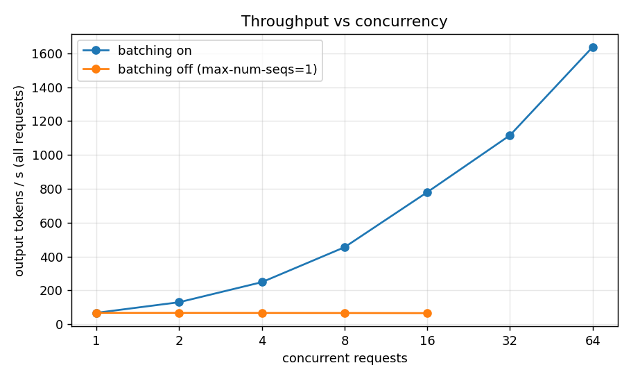
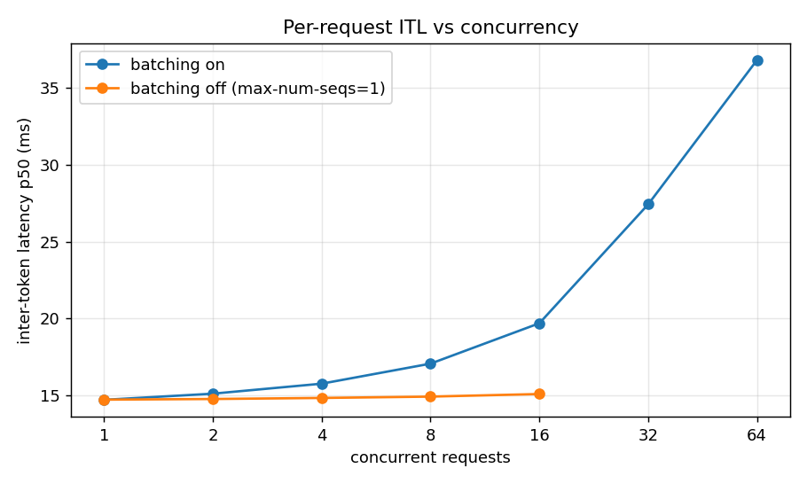
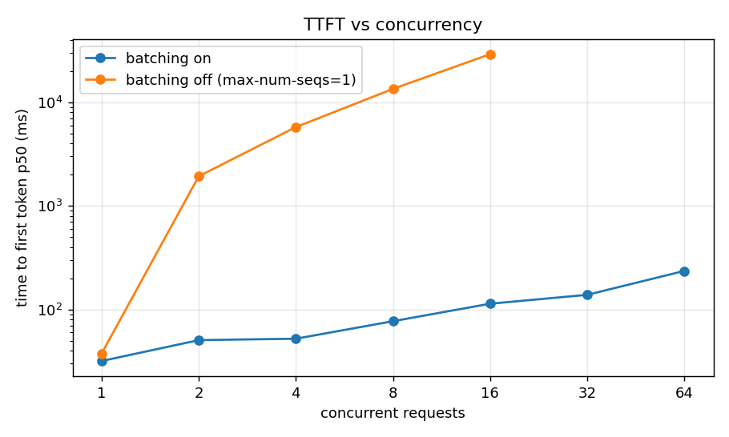
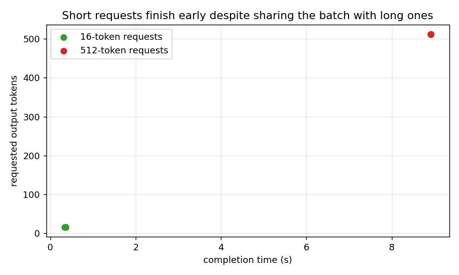
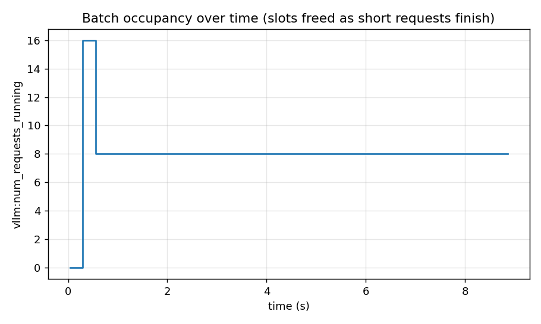

# servellm

Self-hosted OpenAI-compatible LLM serving on vLLM with continuous batching: setup, config walkthrough and measured batching behaviour on a single T4.

Project 1 of 15 in [inference-infra-portfolio](https://github.com/NomanJafar/inference-infra-portfolio).

## What this builds

Serve an open model with vLLM behind an OpenAI-compatible API with continuous batching enabled, and measure what batching actually does to latency and throughput.

## Why it matters

You cannot optimize what you have never served.

## Status

Done. Results from the T4 run are below; raw data, logs and plots are in [`results/kaggle_run5/`](results/kaggle_run5/) (runs 1–4 failed on Kaggle image packaging, and their logs and post-mortems are kept in `results/kaggle_run1..4/`).

## What is in here

| Module | Purpose |
|---|---|
| `servellm.launch` | `ServerConfig` → `vllm serve` command; `VllmServer` starts the process, waits for `/health`, and parses the startup log for KV cache size, token capacity, max concurrency and attention backend |
| `servellm.client` | Minimal streaming `/v1/chat/completions` client that timestamps every chunk and derives TTFT, per-token ITL and token counts |
| `servellm.metrics` | Scrapes `/metrics` and maps the handful of series we care about (running, waiting, KV usage, token counters, server-side TTFT/ITL) to stable names across vLLM versions |
| `servellm.sweep` | Closed-loop load generator: concurrency sweep with a `/metrics` timeline, and a mixed-length run; CLI via `python -m servellm.sweep` |
| `servellm.plots` | Throughput / ITL / TTFT vs concurrency, and the mixed-length finish-time and batch-occupancy charts |

## Experiments

1. **Launch and inspect**: read the KV cache numbers vLLM prints and check them against the hand calculation (≈28 KB per token for Qwen2.5-1.5B in FP16).
2. **Single-stream baseline**: TTFT and ITL for one request at a time; compare ITL to the ~10 ms weight-read floor on a T4.
3. **Concurrency sweep** at 1…64 concurrent streams with fixed prompt and output lengths.
4. **Batching off** (`--max-num-seqs 1`): the same sweep; the gap between the curves is what continuous batching is worth.
5. **Mixed lengths**: short and long requests launched together; short ones should finish early and free their slots.

## Layout

```
CONCEPTS.md     the theory behind the project, written before the code
src/servellm/   implementation
tests/          CPU-only tests, runnable on a laptop
notebooks/      GPU notebooks (Kaggle / Colab) that run the experiments and write results/
results/        measured numbers and plots
```

## Running

Tests (no GPU, no vLLM needed; the client is exercised against a fake SSE server):

```bash
python -m venv .venv && source .venv/bin/activate
pip install -e ".[dev]"
pytest
```

Against a live server (any OpenAI-compatible endpoint works for the client; the startup-log parsing is vLLM-specific):

```bash
vllm serve Qwen/Qwen2.5-1.5B-Instruct --dtype float16 --max-model-len 4096
python -m servellm.sweep --out results/sweep.json sweep --levels 1,2,4,8,16,32,64
python -m servellm.sweep --out results/mixed.json mixed --short 16 --long 512 --n-each 8
```

Full run on a free GPU: open `notebooks/kaggle_servellm.ipynb` on Kaggle (T4) or Colab. It installs vLLM 0.31.0, runs all five experiments and zips `results/`.

## Results (Tesla T4, vLLM 0.31.0, Qwen2.5-1.5B-Instruct FP16, Kaggle, 2026-10-11)

### 1. Launch and inspect

| | |
|---|---|
| Attention backend | `TRITON_ATTN` (chosen out of `TRITON_ATTN`, `FLEX_ATTENTION`; no FlashAttention on Turing, as expected) |
| Model weights | 2.98 GiB, loaded in 29.5 s |
| KV cache | **9.08 GiB = 340,064 tokens**, "maximum concurrency for 4,096 tokens per request: 83.02x" |
| Hand calculation | 340,064 tokens x 28,672 B/token = **9.08 GiB, exact match** (CONCEPTS.md section 4) |
| Same server with `--max-num-seqs 1` | 357,248 tokens: the profiled activation peak shrinks with the batch cap, and the saving goes to cache |

### 2–4. Single stream, concurrency sweep, batching on vs off

Fixed 256-token prompts, exactly 128 output tokens per request, 2 rounds per worker (so the low-concurrency rows have only 2–8 requests; treat their p95 as indicative only).

| concurrency | requests | out tok/s, batching **on** | out tok/s, **off** | TTFT p50 on | TTFT p50 off | ITL p50 on | ITL p95 on | ITL p50 off |
|---|---|---|---|---|---|---|---|---|
| 1 | 2 | **67** | 67 | 32 ms | 38 ms | 14.7 ms | 15.8 ms | 14.7 ms |
| 2 | 4 | **130** | 67 | 51 ms | 1932 ms | 15.1 ms | 15.8 ms | 14.8 ms |
| 4 | 8 | **249** | 67 | 52 ms | 5762 ms | 15.8 ms | 16.4 ms | 14.8 ms |
| 8 | 16 | **455** | 67 | 77 ms | 13464 ms | 17.1 ms | 18.3 ms | 14.9 ms |
| 16 | 32 | **780** | 66 | 114 ms | 29127 ms | 19.7 ms | 21.2 ms | 15.1 ms |
| 32 | 64 | **1116** | – | 138 ms | – ms | 27.4 ms | 32.3 ms | – ms |
| 64 | 128 | **1637** | – | 236 ms | – ms | 36.8 ms | 42.3 ms | – ms |





### 5. Mixed lengths

8 requests of 16 tokens and 8 of 512 tokens launched together: the short ones finished at **0.34–0.36 s**, the long ones at **8.91–8.92 s**; `num_requests_running` went 16 → 8 at t ≈ 0.5 s and stayed there. Nothing waited for anything.




### What the numbers say

1. **Single-stream decode runs at 14.7 ms/token (68 tok/s).** The bandwidth floor from section 1 of the primer is 2.98 GiB / 320 GB/s ≈ 10 ms, so a 1.5B model on a T4 decodes at ~68% of the theoretical bandwidth bound; the same ~70% ceiling the hand-written kernels in `fusedkernels` reach. The primer's "about 100 tokens/s" was the ideal; 68 is the real number.
2. **Continuous batching turned 67 tok/s into 1,637 tok/s (24x) at 64 users while each user's ITL only went from 14.7 to 36.8 ms (2.5x).** That is the memory-bound regime paying off: the same weight read serves 64 sequences. With batching off, aggregate throughput is pinned at 67 tok/s whatever the concurrency.
3. **Where the curve bends.** ITL is flat to 8 concurrent, then climbs steadily (19.7 → 27.4 → 36.8 ms): decode is shifting from memory-bound toward compute-bound. It is *not* a memory limit: KV cache usage peaked at 2.8% and `num_requests_waiting` never left 0. Throughput had not plateaued at 64; the sweep stopped before the knee, and a follow-up to 128–256 would find it (project 15 does this with the `tokenbench` open-loop sweep).
4. **Batching off is a queue, and the numbers are the queue's arithmetic.** Each request takes ~1.9 s (128 x 14.7 ms), so with N users the median wait is ≈ (N−1)/2 x 1.9 s: 1.9 s at 2, 5.8 s at 4, 13.5 s at 8, 29 s at 16. ITL stays at 14.8 ms throughout: once admitted, a request runs alone and fast; the cost is entirely in TTFT. This is what "latency without load curves" hides.
5. **TTFT with batching on grows gently (32 → 236 ms)**, from prefill sharing the GPU with a growing decode batch. The 256-token prefill at concurrency 1 took ~32 ms ≈ 24 TFLOPS effective, a reasonable fraction of the T4's peak.
6. **Short requests leave immediately.** Finish time for the 16-token requests (0.35 s) is what they would take alone; the batch shrinking from 16 to 8 is visible in the server's own metrics. That is the iteration-level scheduling from section 3 of the primer, observed rather than described.

### What was not measured

The throughput knee (sweep stopped at 64); p95 at low concurrency with a meaningful sample count; TTFT for long prompts; the second T4 in the Kaggle session (vLLM used one GPU).

## Hardware notes

Developed against free-tier GPUs (Kaggle and Colab T4, 16 GB). Where a T4 limits what can be measured (no FP8, Turing-era kernels), the README says so rather than papering over it.

## License

MIT
